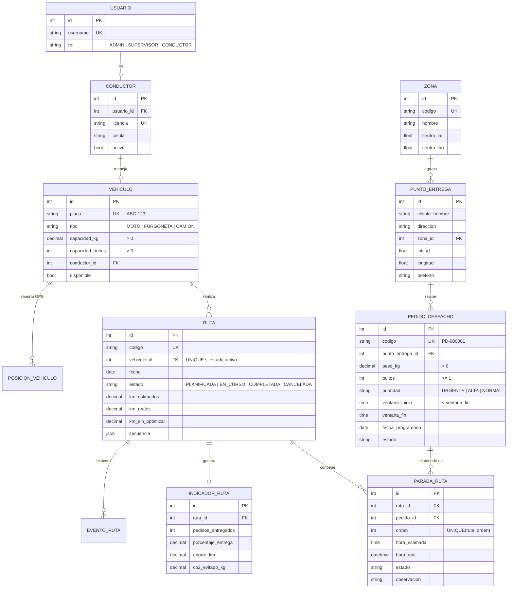

# OptiRuta — Sistema de Optimización de Rutas de Distribución

Solución web empresarial para planificar, optimizar y ejecutar rutas de reparto en Chiclayo.
El sistema asigna pedidos a vehículos según **zona, capacidad y prioridad**, ordena las paradas para
**recorrer menos kilómetros respetando ventanas horarias**, sigue a los vehículos en el mapa y calcula
**KPIs de eficiencia y sostenibilidad** (km, combustible y CO₂ ahorrados).

> Proyecto 4 · Taller de Lenguajes de Programación + Gestión de Proyectos de TI · Universidad Señor de Sipán · 2026-II

| | |
|---|---|
| **Backend** | Python 3.13 · Django 5.2 · Django REST Framework · JWT (SimpleJWT) |
| **Base de datos** | PostgreSQL 17 (administrable con pgAdmin 4) |
| **Frontend** | Django Templates + Bootstrap 5 + JavaScript (consume la API con JWT) · Leaflet + Esri/OpenStreetMap (mapas, sin clave) · Chart.js · SortableJS |
| **Documentación API** | Swagger / OpenAPI en `/api/docs/` |
| **Tiempo real** | Django Channels + Daphne (WebSockets con JWT) |
| **Tareas en segundo plano** | Celery (cola en carpetas en Windows, Redis en Docker) + Celery Beat |
| **Pruebas** | pytest + pytest-django · 124 pruebas · cobertura ≈ 98 % |
| **Despliegue** | Docker + docker compose · Render (render.yaml) · Daphne + whitenoise |

---

## 1. Instalación en Windows (VS Code + PostgreSQL 17 + pgAdmin 4)

**Requisitos:** Python 3.13, PostgreSQL 17 con pgAdmin 4, Git y VS Code.

1. **Crear la base de datos** en pgAdmin 4: clic derecho en *Databases* → *Create* → *Database…* → nombre `optiruta` → *Save*.
2. **Abrir el proyecto** en VS Code y abrir una terminal (`Ctrl + ñ`), luego:

```powershell
python -m venv venv
venv\Scripts\activate
pip install -r requirements.txt
copy .env.example .env
```

3. **Editar `.env`** y poner en `DB_PASSWORD` la contraseña de PostgreSQL que elegiste al instalarlo.
4. **Crear las tablas y cargar datos de demostración:**

```powershell
python manage.py migrate
python manage.py cargar_demo
python manage.py runserver
```

5. Abrir **http://127.0.0.1:8000** e ingresar con:

| Rol | Usuario | Contraseña |
|---|---|---|
| Administrador | `admin` | `Optiruta2026` |
| Supervisor de despacho | `supervisor` | `Optiruta2026` |
| Conductor (ruta en curso) | `conductor1` | `Optiruta2026` |
| Conductores | `conductor2` … `conductor4` | `Optiruta2026` |

> Si PowerShell bloquea `venv\Scripts\activate`, ejecuta una vez: `Set-ExecutionPolicy -Scope CurrentUser RemoteSigned`.
> Para volver a empezar con datos limpios: `python manage.py cargar_demo --reset`.

### Con Docker (alternativa)

```powershell
docker compose up --build
```

Levanta PostgreSQL 17, Redis, la aplicación (Daphne: HTTP + WebSockets), el worker de Celery y Celery Beat;
aplica migraciones y carga la demo. Abrir http://localhost:8000.
El PostgreSQL del contenedor usa el puerto **5433** para no chocar con el instalado en Windows.

### Celery en Windows (opcional, para ver las tareas en segundo plano)

Por defecto (`CELERY_TASK_ALWAYS_EAGER=True` en `.env`) las tareas se ejecutan al instante y no necesitas nada más.
Para verlas trabajar en segundo plano **sin instalar Redis** (la cola vive en la carpeta `.celery/`):

1. En `.env` cambia a `CELERY_TASK_ALWAYS_EAGER=False`.
2. Abre **dos terminales nuevas** en VS Code (con `venv\Scripts\activate`):

```powershell
celery -A config worker --pool=solo -l info     # terminal 2: ejecuta las tareas
celery -A config beat -l info                   # terminal 3: dispara el cierre diario de las 22:00
```

3. En *Reportes de eficiencia* pulsa **Ejecutar cierre del día ahora** y mira la terminal del worker.
   También: `python manage.py cierre_diario --cola`.

---

## 1.1 Publicar en internet (Render, gratis)

1. Sube el proyecto a GitHub (ver sección 13).
2. Entra a https://render.com, inicia sesión con GitHub → **New → Blueprint** → elige el repositorio.
3. Render lee `render.yaml`: crea la base PostgreSQL, instala todo (`build.sh`), migra, carga la demo y arranca Daphne.
4. En 5–10 minutos tendrás un enlace `https://optiruta-xxxx.onrender.com` que abre desde cualquier celular.

> Plan gratuito: el servicio "se duerme" tras 15 minutos sin uso (la primera visita tarda ~1 minuto en despertar)
> y la base de datos gratuita dura 30 días. Ábrelo unos minutos antes de exponer.

---

## 2. Usuarios y roles

| Rol | Qué hace en el sistema |
|---|---|
| **Administrador** | Todo lo del supervisor + gestión de usuarios y conductores, sitio de administración de Django y Swagger. |
| **Supervisor de despacho** | Registra pedidos, planifica rutas (manual o automática), monitorea el mapa del día, cancela rutas y consulta reportes. |
| **Conductor** | Solo ve **su** ruta: la inicia, marca cada parada (entregado / no entregado / reprogramado), comparte su GPS y cierra la ruta. |
| **Cliente final** (sin cuenta) | Consulta el estado de su pedido por código en `/seguimiento/`. |

La protección se aplica en **dos capas**: el frontend redirige según el rol y la API rechaza con `401/403/404` cualquier acceso no permitido (un conductor nunca recibe datos de otra ruta).

---

## 3. Arquitectura y separación de capas (MVC / MVT)

```
optiruta/
├── config/                 Configuración (settings, urls, wsgi)
├── apps/
│   ├── cuentas/            Usuario con rol, login JWT, permisos por rol
│   ├── logistica/          MODELO de datos, SERVICIOS (reglas de negocio), API (vistas + serializers),
│   │                       señales, middleware, PDF, filtros, comando cargar_demo
│   ├── optimizacion/       Motor matemático en Python puro (sin Django): geo, motor, asignación, métricas
│   ├── reportes/           KPIs de eficiencia y resumen del dashboard
│   └── web/                Vistas de páginas (plantillas)
├── templates/              Plantillas HTML (Bootstrap 5)
├── static/                 CSS, JS (cliente JWT) y librerías locales (funciona sin CDN)
├── tests/                  Pruebas unitarias y de integración
├── Dockerfile · docker-compose.yml
```

| Capa | Dónde | Responsabilidad |
|---|---|---|
| Modelo | `apps/*/models.py` | Entidades, relaciones, índices y *constraints* en PostgreSQL |
| Lógica de negocio | `apps/logistica/servicios.py`, `apps/optimizacion/` | Reglas críticas, transacciones atómicas, algoritmos |
| Formularios | `apps/logistica/forms.py` (ModelForms) | Reglas de validación de entrada; los usan la API (serializers) y el admin |
| Serialización | `serializers.py` | Formato JSON de la API; delegan la validación en los formularios |
| Controlador | `views.py` (ViewSets DRF) | Recibe la petición, valida y delega en servicios |
| Vista | `templates/` + `static/js/` | Interfaz de usuario |

---

## 4. Modelo de datos



**Integridad garantizada por la base de datos:**
- `una_ruta_activa_por_vehiculo`: índice único **parcial** sobre `vehiculo` cuando `estado ∈ {PLANIFICADA, EN_CURSO}`.
- `orden_unico_por_ruta` y `pedido_unico_por_ruta` en las paradas.
- `CHECK` de peso > 0, bultos ≥ 1, capacidades > 0 y `ventana_inicio < ventana_fin`.
- `ruta_peso_dentro_de_capacidad` y `ruta_bultos_dentro_de_capacidad`: `CHECK (peso_total_kg <= capacidad_kg)` y `CHECK (bultos_total <= capacidad_bultos)`; cada ruta guarda la capacidad del vehículo al planificarse, así PostgreSQL rechaza una ruta con sobrecarga aunque se escriba directo en la base de datos.
- Índices en `(estado, fecha_programada)`, `prioridad`, `(fecha, estado)` de rutas y `(vehiculo, -registrado)` del GPS.

---

## 5. Reglas de negocio

| Código | Regla | Implementación |
|---|---|---|
| RN1 | Un vehículo no puede tener dos rutas activas | Validación en servicio + índice único parcial |
| RN2 | La suma de pesos (y bultos) no supera la capacidad del vehículo | `_validar_capacidad` + algoritmo FFD + barra de capacidad en la UI |
| RN3 | Los pedidos URGENTES tienen prioridad en el orden de paradas | El motor atiende primero los urgentes que ya se pueden atender; si su ventana aún no abre, no hace esperar al conductor |
| RN4 | La ruta no se cierra si tiene paradas pendientes | `cerrar_ruta` devuelve 409 con la lista de paradas |
| RN5 | Se respetan las ventanas horarias | Penalización β en la función objetivo + simulación de tiempos |
| RN6 | Las paradas se atienden en el orden optimizado | Solo la siguiente parada puede pasar a EN_CAMINO |
| RN7 | FALLIDO o REPROGRAMADO exige observación | Validación en servicio y formulario |
| RN8 | El conductor solo opera su ruta y su vehículo | Filtrado de querysets + validación en servicio |
| RN9 | Máximo 20 paradas por ruta y aviso si se excede la jornada de 9 h | Configurable en `settings.OPTIRUTA` |
| RN10 | Máquina de estados: solo transiciones válidas | `TRANSICIONES_PARADA` en servicios; los estados finales no cambian |


Transiciones de una parada: `PENDIENTE → EN_CAMINO → ENTREGADO | FALLIDO | REPROGRAMADO` (y `PENDIENTE → REPROGRAMADO`).
Un pedido reprogramado vuelve a la lista de pendientes para el día siguiente.

---

## 6. La optimización (modelos matemáticos)

### 6.1 Distancia: fórmula de Haversine
```
a = sin²(Δφ/2) + cos φ1 · cos φ2 · sin²(Δλ/2)
d = 2 · R · atan2(√a, √(1−a))           R = 6371 km
d_vial = k · d                           k = 1.3 (factor de circuito urbano)
```

### 6.2 Asignación de pedidos a vehículos: Bin Packing 2D con *First Fit Decreasing*
```
Σ peso_p · x_pv ≤ capacidad_kg_v       ∀ v
Σ bultos_p · x_pv ≤ capacidad_bultos_v ∀ v
Σ x_pv ≤ 20                            ∀ v   (paradas por jornada)
Σ_v x_pv ≤ 1                           ∀ p
```
Pedidos ordenados por prioridad y peso descendente; cada uno va al primer vehículo donde cabe,
probando primero los que ya atienden su zona (afinidad de zona). Ver `apps/optimizacion/asignacion.py`.

### 6.3 Orden de visita: TSP con prioridades y ventanas horarias
```
minimizar Z(π) = Σ d(π_k, π_k+1) + α · Σ espera_k + β · Σ tardanza_k + Π · V_prioridad

llegada_k  = salida_(k−1) + d / v · 60
inicio_k   = max(llegada_k, ventana_inicio_k)
espera_k   = inicio_k − llegada_k
tardanza_k = max(0, llegada_k − ventana_fin_k)
salida_k   = inicio_k + s                         (s = 8 min de descarga)
V_prioridad = urgentes postergados detrás de un no urgente cuando ya estaban disponibles
              (su ventana abría en ≤ 15 min)
α = 0.25 km/min,  β = 50 km/min,  Π = 1000,  v = 25 km/h
```
**Fase 1 — Vecino más cercano con costo compuesto:** desde el almacén se elige la parada de menor costo
(distancia × factor de prioridad + penalizaciones). Si hay urgentes que ya se pueden atender, se elige entre ellos;
un urgente cuya ventana aún no abre no hace esperar al conductor: se atienden otros pedidos mientras tanto.
**Fase 2 — Mejora 2-opt:** se invierten tramos de la ruta mientras el costo total disminuya
(elimina los cruces). Ver `apps/optimizacion/motor.py`.

### 6.4 Comparación antes / después y sostenibilidad
Cada ruta guarda los km del **orden de llegada** (como se hacía manualmente) y los km **optimizados**:
```
ahorro_km  = km_manual − km_optimizado
litros     = km · rendimiento / 100       (moto 3, furgoneta 10, camión 18 L/100 km)
CO₂ (kg)   = litros · factor              (gasolina 2.31, diésel 2.68 kg/L — IPCC 2006)
% entrega  = entregados / asignados · 100
```

---

## 7. API REST

Documentación interactiva: **`/api/docs/`** (Swagger) y `/api/redoc/`. Autenticación: `Authorization: Bearer <token>`.

| Método | Endpoint | Descripción | Rol |
|---|---|---|---|
| POST | `/api/auth/login/` | Obtiene `access`, `refresh` y datos del usuario | Público |
| POST | `/api/auth/refresh/` | Renueva el token | Público |
| **POST** | **`/api/rutas/planificar/`** | Crea una ruta optimizada con vehículo y pedidos | Supervisor/Admin |
| **GET** | **`/api/rutas/{id}/paradas/`** | Secuencia de paradas con horas estimadas | Todos (filtrado) |
| **PATCH** | **`/api/paradas/{id}/estado/`** | Cambia el estado con validación de transición | Conductor dueño / Supervisor |
| **GET** | **`/api/rutas/en-curso/`** | Rutas activas con posición actual | Todos (filtrado) |
| **POST** | **`/api/vehiculos/{id}/posicion/`** | Registra posición GPS | Conductor dueño |
| **GET** | **`/api/reportes/eficiencia/?fecha=`** | KPIs (también `desde`, `hasta`, `vehiculo`, `formato=csv` o `formato=pdf`) | Supervisor/Admin |
| **GET** | **`/api/pedidos/sin-asignar/`** | Pedidos pendientes (filtros `zona`, `prioridad`, `fecha`) | Supervisor/Admin |
| **GET** | **`/api/zonas/{id}/pedidos-hoy/`** | Pedidos del día por zona | Supervisor/Admin |
| POST | `/api/rutas/previsualizar/` | Calcula la ruta óptima sin guardar (comparativa) | Supervisor/Admin |
| POST | `/api/rutas/planificar-automatico/` | Reparte todos los pendientes entre la flota (FFD) | Supervisor/Admin |
| POST | `/api/rutas/{id}/iniciar/` · `/cerrar/` · `/cancelar/` | Ciclo de vida de la ruta | Según rol |
| GET | `/api/rutas/mi-ruta/` | Ruta actual del conductor | Conductor |
| GET | `/api/rutas/{id}/hoja-ruta/` | Hoja de ruta en PDF | Todos (filtrado) |
| GET | `/api/rutas/{id}/eventos/` | Bitácora de la ruta | Todos (filtrado) |
| GET | `/api/reportes/resumen/` | Tarjetas del dashboard | Supervisor/Admin |
| POST | `/api/reportes/cierre-diario/` | Lanza la tarea de Celery del cierre del día | Supervisor/Admin |
| WS | `/ws/mapa/?token=<JWT>` | WebSocket: posiciones, paradas y rutas en vivo | Supervisor/Admin |
| GET | `/api/seguimiento/{codigo}/` | Estado público de un pedido (sin datos personales) | Público |
| CRUD | `/api/pedidos/`, `/api/puntos-entrega/`, `/api/vehiculos/`, `/api/conductores/`, `/api/zonas/`, `/api/usuarios/` | Mantenimientos con paginación, búsqueda y filtros | Según rol |

Errores con formato uniforme y código HTTP correcto (`400` validación, `401`, `403`, `404`, `409` conflicto de negocio):
```json
{ "error": "No se puede cerrar: hay 2 parada(s) pendiente(s) (RN4).", "codigo": "paradas_pendientes", "detalle": { "paradas": [4, 5] } }
```

---

## 8. Pantallas

| Pantalla | Ruta | Rol |
|---|---|---|
| Login con mini-optimizador interactivo (puntos arrastrables) | `/login/` | Público |
| Mapa del día: vehículos en vivo, rutas y KPIs (se actualiza cada 10 s) | `/app/dashboard/` | Supervisor/Admin |
| Pedidos sin asignar: filtros, selección y registro con ubicación en mapa | `/app/pedidos/` | Supervisor/Admin |
| Planificación: arrastrar pedidos a vehículos, barra de capacidad, comparativa antes/después | `/app/planificar/` | Supervisor/Admin |
| Detalle de ruta: línea de tiempo, mapa, KPIs y bitácora | `/app/rutas/{id}/` | Todos |
| Mi ruta (conductor, pensada para celular): parada actual, botones grandes, GPS | `/app/conductor/` | Conductor |
| Reportes de eficiencia: gráficos, comparativa por vehículo, exportar CSV | `/app/reportes/` | Supervisor/Admin |
| Historial de rutas | `/app/historial/` | Supervisor/Admin |
| Flota y conductores | `/app/flota/` | Supervisor/Admin |
| Seguimiento público del pedido | `/seguimiento/` | Cliente |

---

## 9. Casos de uso principales

| ID | Caso de uso | Actor |
|---|---|---|
| CU01 | Iniciar sesión según rol | Todos |
| CU02 | Registrar pedido de despacho (con ventana horaria y ubicación) | Supervisor |
| CU03 | Planificar ruta manual con optimización y comparativa | Supervisor |
| CU04 | Planificar toda la flota automáticamente | Supervisor |
| CU05 | Monitorear rutas en el mapa del día | Supervisor |
| CU06 | Iniciar ruta y atender paradas (entregado / fallido / reprogramado) | Conductor |
| CU07 | Compartir ubicación GPS | Conductor |
| CU08 | Cerrar ruta con cálculo automático de KPIs y notificación por correo | Conductor |
| CU09 | Consultar reportes de eficiencia y exportar | Supervisor / Admin |
| CU10 | Gestionar flota, conductores y usuarios | Admin |
| CU11 | Consultar estado de un pedido | Cliente |

---

## 10. Pruebas

```powershell
pytest --cov                                   # SQLite en memoria (rápido)
pytest --ds=config.settings_test_pg            # contra PostgreSQL real (usa tu .env)
pytest --cov --cov-report=html                 # reporte navegable en htmlcov/index.html
```

| Archivo | Qué prueba |
|---|---|
| `tests/test_optimizacion.py` | Haversine, matriz de distancias, vecino más cercano, 2-opt, urgentes primero, ventanas, FFD, métricas |
| `tests/test_reglas_negocio.py` | RN1–RN9, transiciones de estado, señales, cierre con KPIs y correo, cancelación, GPS |
| `tests/test_api.py` | Login JWT, permisos por rol, endpoints mínimos, códigos HTTP, validaciones (celular +51, correo), reportes, CSV, PDF, seguimiento, Celery (cierre diario) |
| `tests/test_formularios.py` | Capa de formularios y restricción de capacidad en PostgreSQL |
| `tests/test_tiempo_real.py` | WebSocket: conexión con JWT, eventos de posición/parada/ruta al instante, rechazo sin permiso |

---

## 11. Temas del curso aplicados

| Tema | Dónde |
|---|---|
| Entornos virtuales, Docker | `venv`, `Dockerfile`, `docker-compose.yml` |
| ORM, relaciones, migraciones, shell | `models.py`, `migrations/`, `cargar_demo` |
| URLs, vistas, plantillas, formularios, admin, autenticación | `apps/web`, `templates/`, `/admin/` |
| Mensajes, correo, plantillas de correo, PDF | Avisos en UI, `notificar_cierre`, `templates/correos/`, `logistica/pdf.py` (hoja de ruta), `reportes/pdf.py` (reporte de eficiencia) |
| DRF: serializers, vistas genéricas, ViewSets, serializers anidados, paginación, filtros, JWT | `serializers.py`, `views.py`, `filtros.py`, `paginacion.py` |
| Caché, logging, throttling, señales, middleware propio | `reportes/views.py`, `settings.py`, `signals.py`, `middleware.py` |
| Usando Celery con Python y Django | `config/celery.py`, `apps/logistica/tasks.py` (cierre diario programado, correos en segundo plano) |
| Despliegue a ambientes productivos | `render.yaml`, `build.sh`, `Dockerfile`, `docker-compose.yml` |

---

## 12. Tiempo real y tareas automáticas

**WebSockets (Django Channels).** El mapa del día y el detalle de ruta se conectan a `/ws/mapa/` con el mismo token JWT.
Cada vez que el conductor envía su GPS, marca una entrega o una ruta cambia de estado, la capa de servicios publica un
evento (solo cuando la transacción se confirma) y los camiones se mueven al instante. Si la conexión se cae, la página se
reconecta sola y mientras tanto consulta la API cada 10 s. En desarrollo el canal funciona en memoria; con `REDIS_URL` usa Redis.

**Celery.** `cierre_diario` se programa con Celery Beat a las 22:00: reprograma para mañana los pedidos sin ruta y las
entregas fallidas, calcula los KPIs del día y envía a supervisión un correo con el **reporte de eficiencia en PDF**.
El correo de cierre de cada ruta también se envía en segundo plano. Si la cola no está disponible, la tarea se ejecuta
en línea para no perder nada.

---

## 13. Subir a GitHub y dar acceso al docente

```powershell
git init
git add .
git commit -m "OptiRuta: sistema de optimización de rutas de distribución"
git branch -M main
git remote add origin https://github.com/<tu-usuario>/optiruta.git
git push -u origin main
```

Luego en GitHub: **Settings → Collaborators → Add people** y agrega al docente. El archivo `.env` no se sube
(está en `.gitignore`), así tu contraseña queda solo en tu computadora.

---

## 14. Equipo

Integrantes: Adelith Piñin Fernandez · Maria Fernanda Mori Cumpen · Ruth Chapoñan Alayo · Sergio Cedano Salinas · Evelyn Leyva Juárez · Cristian Manuel Gonzalez Becerra.

Docente: Carlos William Atalaya Urrutia — Taller de Lenguajes de Programación.
